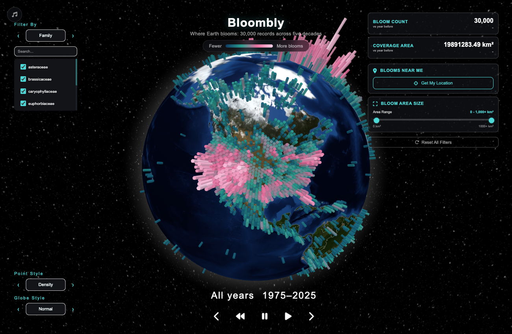
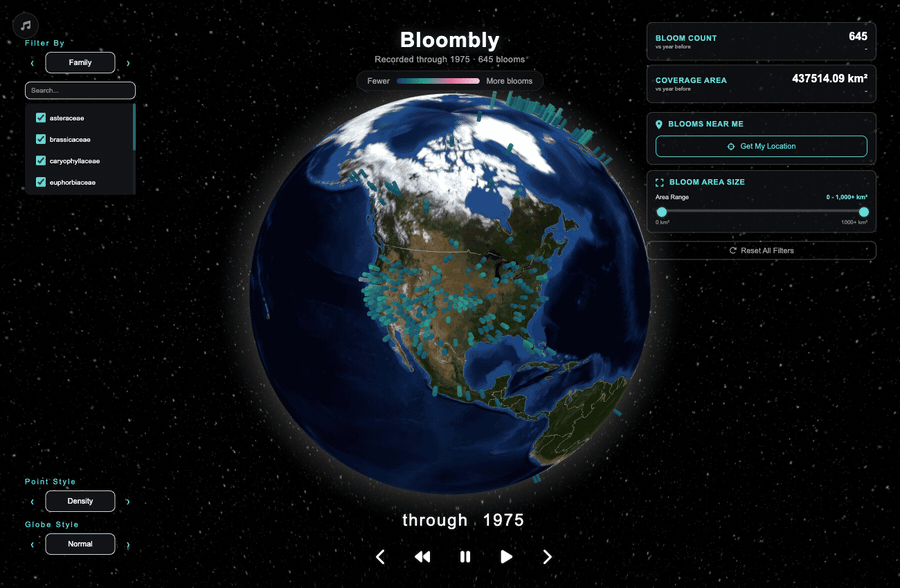
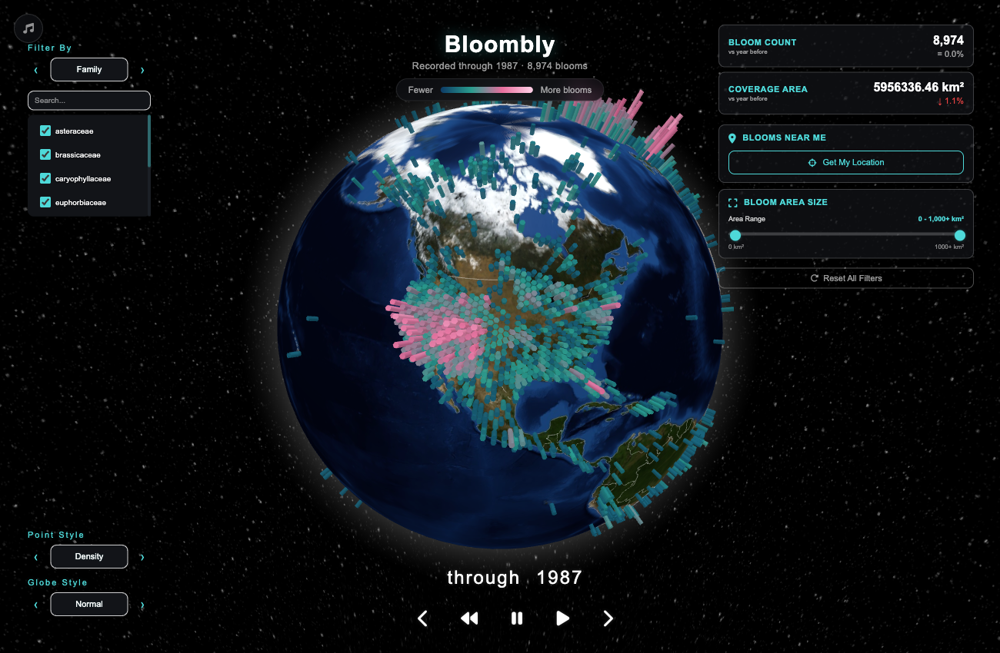
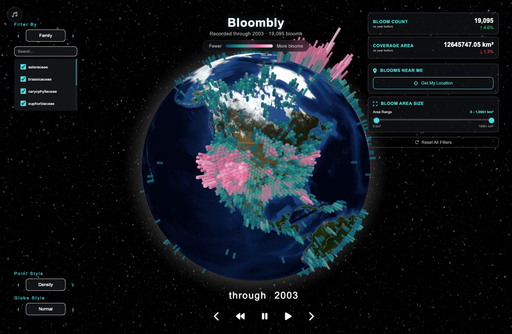
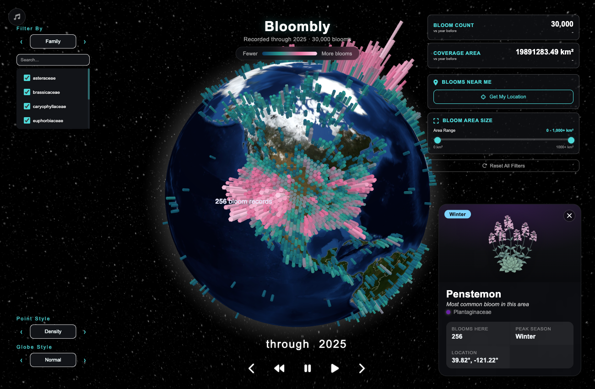
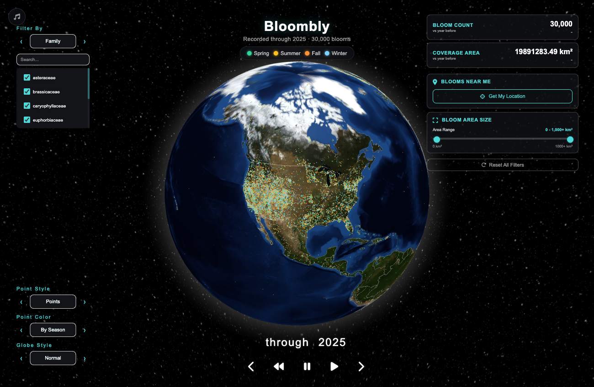

# Bloombly

**50 years of plant blooms on Earth, told on a living 3D globe.** Where life blooms, when in the year, and how the record grew decade by decade.

[](https://developer.mozilla.org/en-US/docs/Web/JavaScript)
[](https://threejs.org/)
[](https://www.python.org/)
[](https://flask.palletsprojects.com/)
[](https://earthengine.google.com/)
[](https://www.spaceappschallenge.org/)

[](https://youtu.be/On70ydW8hGE)



---

## What you see

Bloombly opens straight on a living globe, turning slowly against a night sky. Then the story starts on its own. It begins in 1975 with only the first few records on the map. Year by year the record fills in and the columns climb, until 2025 shows half a century of flowering observations stacked on top of each other. A caption narrates as it goes ("Recorded through 1987, 8,974 blooms"), and when it reaches the present it loops back and tells it again.

Pause it at any year, click a column, and you meet the plant that blooms most often there.



| 1987 | 2003 |
| :---: | :---: |
|  |  |

## Features

- **Living globe on load.** No landing page, no setup. The globe rotates slowly on a night-sky backdrop the moment the page opens.
- **Density heatmap by default.** Blooms are aggregated into hexagonal columns. Height and color (deep blue to teal to magenta to pink) both encode how many records fall in that cell, with a legend to read them.
- **A 50-year story that plays itself.** The timeline is cumulative, so the heatmap visibly grows from 1975 to 2025 while a caption narrates the running total. Play, pause, rewind, or step one year at a time.
- **Species cards.** Click any hexagon to open a card for the most common bloom in that area: its illustration, its family, how many blooms are recorded there, and its peak season.
- **Points mode.** Switch Point Style to Points to see individual blooms colored by season (spring, summer, fall, winter) with a matching legend, or recolor them by family or genus.
- **Filters.** Narrow the globe by family or genus, by distance from your location, or by bloom area.
- **Metrics panel.** Bloom count and coverage area at a glance.
- **Ambient soundscape.** An optional soundtrack synthesized live with the Web Audio API (no audio files), toggled from the corner button.





## How it works

### The data

Bloombly is built on a global flowering-sites dataset: **554,467 records from 1975 to 2025.** The browser sample spans 8 plant families and 31 genera, and every genus has its own illustration in `frontend/public/images`, which is what the species cards show.

The full dataset (`data/geojson/flowering_sites.geojson`) is about 467 MB. That is far too much for a browser, so the app loads a **30,000-record sample** instead (`data/geojson/flowering_sites.sample.geojson`, about 8 MB). Regenerate the sample any time with:

```bash
python scripts/sample_blooms.py
```

### The visualization

- **Stack:** vanilla JavaScript, [three.js](https://threejs.org/) and [globe.gl](https://globe.gl/). No framework, no build step. It is a static site.
- **Heatmap:** records are binned into hexagons. Column height and a four-stop color ramp (deep blue, teal, magenta, pink) both scale with record count.
- **Timeline:** cumulative. Each frame shows every bloom recorded up to that year, so the story is about the record growing, not a single year in isolation.
- **Points:** each record is drawn individually and colored by season of bloom, or by family or genus.
- **Species cards:** for a clicked hexagon, the app finds the most common bloom in that area and shows its illustration, family, count and peak season.
- **Sound:** synthesized in the browser with the Web Audio API. Nothing is downloaded.

## Run locally

```bash
cd frontend
npm install
npm start
```

Then open [http://localhost:3000](http://localhost:3000). The globe works fully on its own; the prediction API below is optional.

## Deploy

The whole app is static and lives under `frontend/public`, data included. On Vercel, set **Root Directory** to `frontend/public` with no build command and no output directory. It also works on any other static host that can serve that folder. Full steps are in [`DEPLOY.md`](DEPLOY.md).

## The machine-learning pipeline

Bloombly started at the NASA Space Apps Challenge as a bloom detection and forecasting project, and the repository still contains that side: a Flask API in `api/` and a training pipeline in `ml/`.


**Honest status:** the live app is a historical explorer. The forecasting API is not wired into it. Running the API requires a Google Earth Engine service account and a trained model artifact, which is not committed. See [`api/.env.example`](api/.env.example) and [`DEPLOY.md`](DEPLOY.md).

### Data sources

- **NASA POWER API:** meteorological variables (temperature, precipitation, humidity)
- **NASA AppEEARS:** vegetation indices (NDVI, EVI, EVI2) and land surface products
- **Google Earth Engine:** satellite imagery and large-scale geospatial processing
- **OpenLandMap:** soil properties (texture, moisture, temperature)
- **GBIF / iNaturalist:** citizen science observations for ground truth

### Processing steps

1. **Feature extraction:** build the model's 75 features from 25 raw variables plus 49 engineered ones (35 weather, 8 soil, 2 NDVI, 1 elevation, 3 photoperiod).
2. **Quality control:** cloud masking and removal of sensor anomalies.
3. **Temporal alignment:** resample and align the different time series.
4. **Spatial standardization:** reproject to WGS84 and normalize resolutions.
5. **Missing data:** spatial and temporal interpolation.
6. **GeoJSON export:** convert processed outputs to web-ready formats.

### Model

A gradient boosting classifier built with scikit-learn (`GradientBoostingClassifier`), evaluated against a random forest baseline.

- **Training set:** 1,934 bloom observations from 2013 onward (earlier records have no NDVI satellite coverage).
- **Validation:** time-series cross-validation to avoid data leakage.
- **Output:** the probability that a given location is in bloom (a confidence score).

```
Input features (75) -> gradient boosting model -> Bloom / Not Bloom -> Probability
```

### Running the API

```bash
cd api
python -m venv .venv && source .venv/bin/activate
pip install -r requirements.txt
cp .env.example .env         # fill in EE_PROJECT and GOOGLE_APPLICATION_CREDENTIALS_JSON
python -m app.main           # http://localhost:5001
```

The API runs on its own (`GET /api/health` reports whether Earth Engine is available). The live frontend does not call it.

### Tech stack

**Frontend**

| Technology           | Purpose                         |
| -------------------- | ------------------------------- |
| JavaScript (vanilla) | App logic, no framework         |
| three.js / globe.gl  | 3D globe and hexagon rendering  |
| Web Audio API        | Live-synthesized soundscape     |
| HTML5 / CSS3         | UI structure and styles         |

**Backend and ML**

| Technology              | Purpose                                     |
| ----------------------- | ------------------------------------------- |
| Python 3.9+             | Core logic and data processing              |
| Flask                   | REST API and prediction endpoints           |
| scikit-learn            | Gradient boosting classifier, scaling, time-series cross-validation |
| pandas / NumPy          | Data manipulation and numerical ops         |
| Google Earth Engine API | Satellite access and large-scale processing |

## Project structure

```
bloombly/
├── frontend/        # The app: static site under frontend/public (index.html, js/, styles/, images/, data/)
├── data/            # GeoJSON datasets: full flowering-sites file, browser sample, prediction outputs
├── scripts/         # sample_blooms.py, builds the 30,000-record browser sample
├── api/             # Flask prediction API (optional, needs Earth Engine + a trained model)
├── ml/              # Data cleaning and feature pipeline for model training
├── backend/         # Cleaning and conversion scripts for the source datasets (CSV/JSON to GeoJSON)
├── docs/            # Screenshots and documentation assets
└── DEPLOY.md        # Static deploy guide and API notes
```

## Data sources and credits

- **NASA POWER API:** meteorological variables (resolution ~0.5°, coverage 1981–present, daily updates)
- **NASA AppEEARS:** vegetation indices and land surface products (MODIS, VIIRS; 250 m–1 km)
- **Google Earth Engine:** multi-spectral imagery and scalable processing
- **OpenLandMap:** soil property layers (250 m resolution)
- **GBIF / iNaturalist:** ground-truth observations for training and validation

Built for the [NASA Space Apps Challenge](https://www.spaceappschallenge.org/), whose prompt asked teams to use NASA Earth observations to build a dynamic visual tool that detects or displays plant blooming events worldwide.

Thanks to the NASA Earth Science Division, the Google Earth Engine team, the NASA Space Apps Challenge organizers, the citizen scientists on iNaturalist and GBIF, and the open-source projects this is built on.

## Contributing

Contributions are welcome! To get started:

```bash
git clone https://github.com/LeonardoCerv/bloombly.git
cd bloombly/frontend && npm install && npm start
```

Then fork the repository, create a branch for your change, commit it, push the branch and open a pull request. Keep the globe usable without the API: it is the part everyone sees.

## License

This project is licensed under the MIT License. See [LICENSE](LICENSE).

Third-party licenses: three.js (MIT), globe.gl (MIT), scikit-learn (BSD 3-Clause), NASA data (public domain, U.S. Government).

---

Made by [Leonardo Cervantes](https://github.com/LeonardoCerv).
